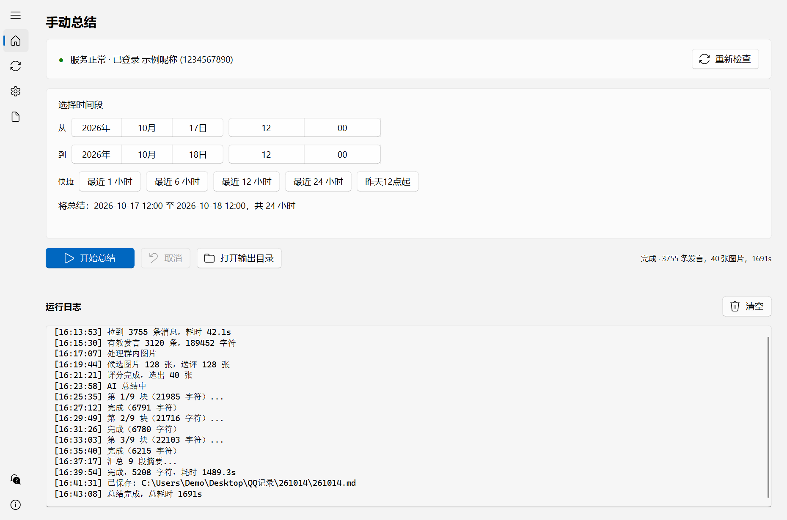
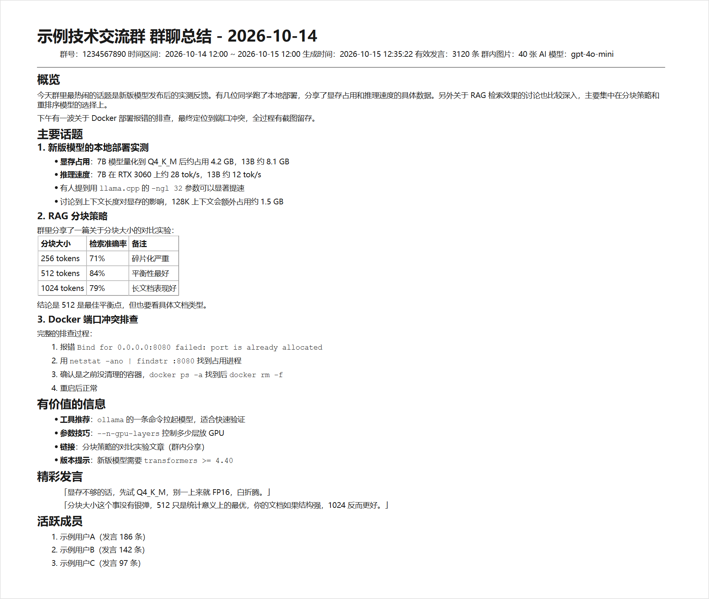
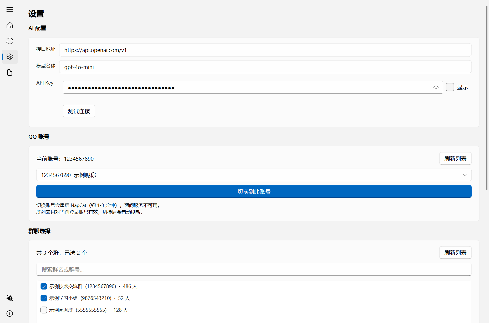
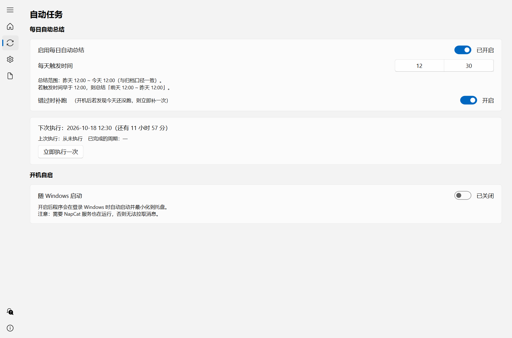
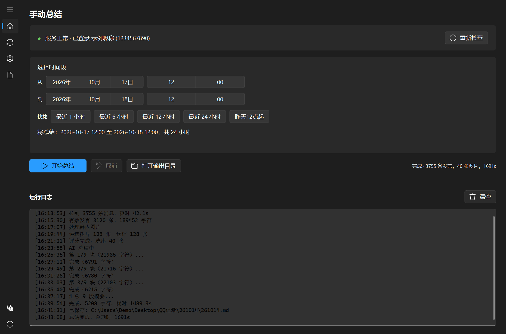
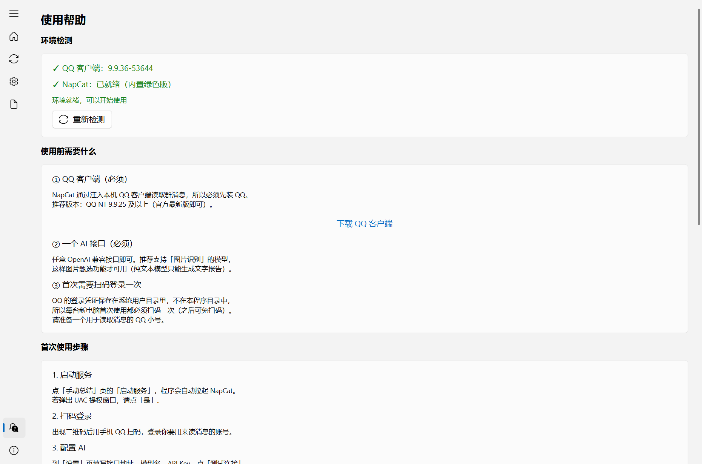
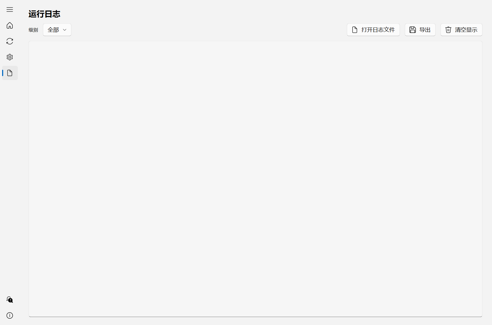
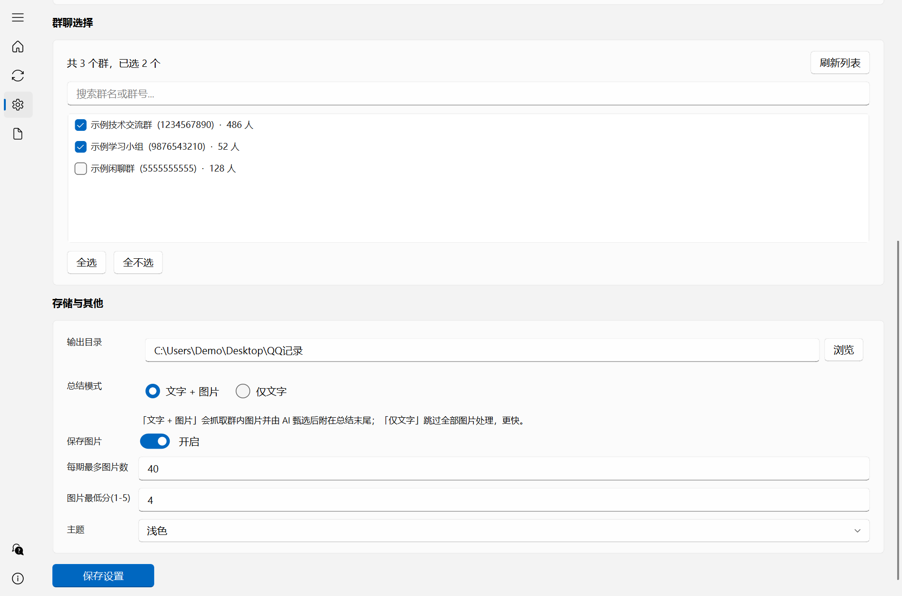
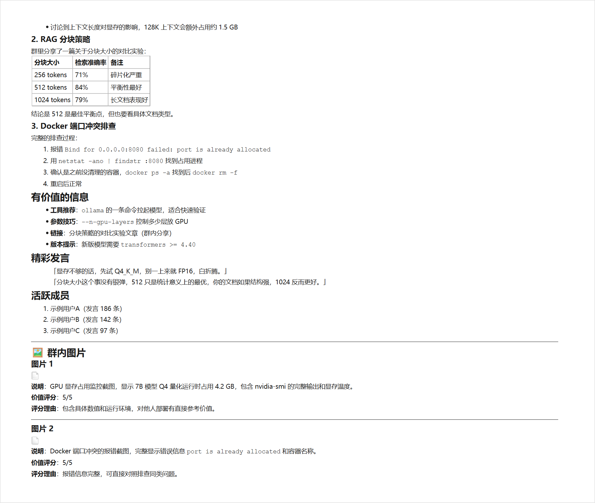
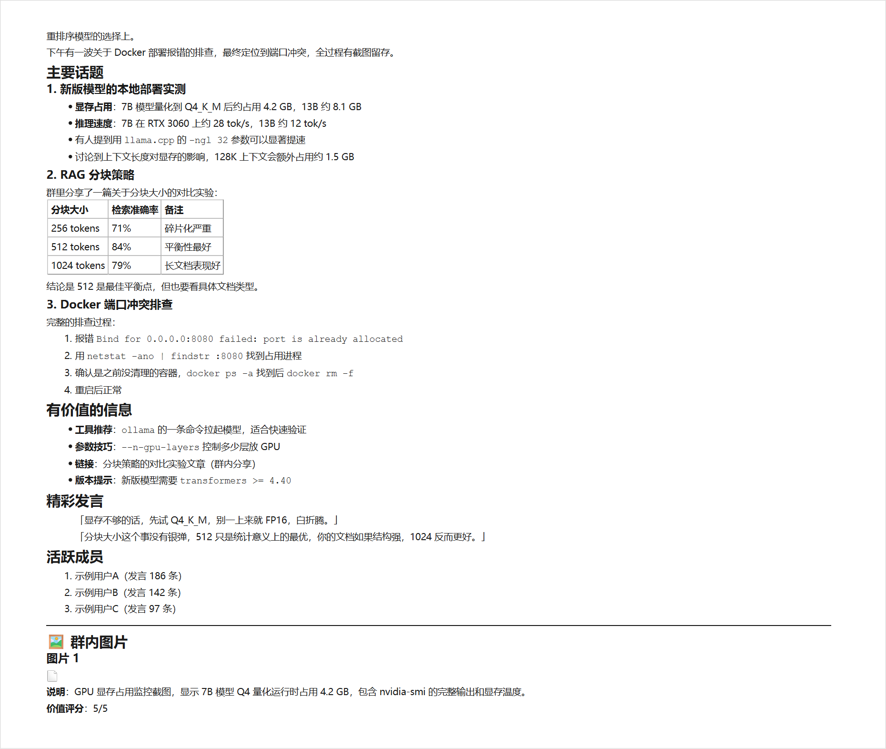

# QQ 群聊总结器

拉取 QQ 群聊天记录 → 大模型总结 + 图片甄选 → 归档为 Markdown 的 Windows 桌面程序。

**一句话说明**：你一天没看群，它能帮你把群里聊了什么、有哪些重点、有哪些有用的图片，整理成一份可读的日报，存到你自己的电脑上。

[](https://github.com/nanwaynan/QQ_Summarizer/releases/latest)
[](https://github.com/nanwaynan/QQ_Summarizer/actions/workflows/check.yml)
[](LICENSE)
[]()
[](https://www.python.org/downloads/)
[]()
[]()
[]()
[]()
[]()
[]()

> **下载**：不想装 Python 的话，直接去 [**Releases**](https://github.com/nanwaynan/QQ_Summarizer/releases/latest) 下载压缩包，解压双击 `启动.bat` 即可。
> **关于上面几个徽章**：`向群聊发消息 0` 和 `遥测上报 0` 是本程序的设计承诺 —— 只读取、不写入、不上报。`定时任务 支持` 指每日自动总结功能。

> 📌 **第一次用？** 直接跳到 [第二章「30 秒快速上手」](#二30-秒快速上手)，看完就能跑起来。
> 🔧 **想改代码？** 看 [第三章 方式一：源码版](#方式一源码版source_code_version)。
> ❓ **遇到问题？** 看 [第七章 FAQ](#七常见问题faq)，那里按症状分类了 40 个问题。

---

## 界面预览

**主界面** —— 服务状态、时间段选择、实时进度



**总结结果** —— 归档为 Markdown，含表格、引用、图片说明



<table>
<tr>
<td width="50%">

**设置页** —— AI / 账号 / 群聊 / 存储


</td>
<td width="50%">

**自动任务** —— 定时 / 补跑 / 开机自启


</td>
</tr>
<tr>
<td width="50%">

**深色主题**


</td>
<td width="50%">

**使用帮助** —— 环境检测 + FAQ


</td>
</tr>
</table>

<details>
<summary>更多截图（日志页、存储设置、图片章节）</summary>

<table>
<tr>
<td width="50%">

**运行日志**


</td>
<td width="50%">

**存储与总结模式**


</td>
</tr>
<tr>
<td width="50%">

**图片章节（AI 甄选 + 评分理由）**


</td>
<td width="50%">

**话题详情**


</td>
</tr>
</table>

</details>

---

## 目录

- [界面预览](#界面预览)
- [一、项目简介](#一项目简介)
- [二、30 秒快速上手](#二30-秒快速上手)
- [三、各版本使用说明](#三各版本使用说明)
- [四、界面详解](#四界面详解)
- [五、前置环境要求](#五前置环境要求)
- [六、配置说明](#六配置说明)
- [七、常见问题 FAQ](#七常见问题faq)
- [八、输出文件详解](#八输出文件详解)
- [九、目录结构说明](#九目录结构说明)
- [十、技术说明](#十技术说明)
- [十一、免责声明](#十一免责声明)


## 一、项目简介

### 1.1 它解决什么问题

**为什么做这个**

每天 QQ 群里的信息量太大了，爬楼根本爬不完。QQ 自带的元宝总结确实能帮一把，但**看完就没了，留不下存档，也没法一天一天连续地总结下去**。

这个工具把每一天的群聊沉淀成一份 Markdown 文件：AI 帮你读完几千条消息，挑出话题、干货、精彩发言；重要图片也一起保留。今天写的，明年还能翻出来查。

**它具体怎么做**

```
你的 QQ  ←─(NapCat 读取)─→  本程序  ←─(API 调用)─→  AI 大模型
                                │
                                ↓
                     桌面\QQ记录\261014\261014.md
```

1. 从你**已登录的本机 QQ** 里，把指定群在指定时间段的消息全部拉下来
2. 交给大模型总结成结构化报告（概览 / 主要话题 / 有价值的信息 / 精彩发言 / 活跃成员）
3. 顺便把群里发的图片用 AI 筛一遍，只留有价值的（报错截图、教程步骤、数据图表等），并自动配文字说明
4. 存成 Markdown 文件，按日期归档到本地

**全程不上传你的聊天记录到任何第三方服务器**，唯一的外部通信是你自己配置的 AI 接口。

### 1.2 核心功能

#### 总结相关

| 功能 | 说明 |
|---|---|
| **时间段总结** | 自选任意 ≤24 小时的时间段；快捷按钮：最近 1/6/12/24 小时、昨天12点起 |
| **两种总结模式** | 「文字 + 图片」（AI 甄选图片并配说明）/ 「仅文字」（跳过图片，更快更省） |
| **智能分块** | 记录超 2.2 万字自动分块，逐块总结后再汇总，不会撑爆模型上下文 |
| **保留细节** | 提示词要求保留工具名、链接、版本号、命令等具体信息，不做空洞概括 |
| **原始记录留档** | 输出文件里附完整原始聊天记录（默认折叠，点开可见） |

#### 自动化

| 功能 | 说明 |
|---|---|
| **每日自动任务** | 定时自动总结（默认每天 12:30） |
| **错过补跑** | 开机后发现今天该跑但没跑，自动补一次（默认限 6 小时内） |
| **同周期去重** | 同一时段只总结一次，不会重复生成文件 |
| **开机自启** | 随 Windows 启动，静默进托盘（写 HKCU 注册表，不需要管理员权限） |

#### 易用性

| 功能 | 说明 |
|---|---|
| **服务自检** | 启动时自动检测 NapCat，没运行就拉起，没登录就弹二维码 |
| **多群选择** | 一次可勾选多个群，支持搜索过滤 |
| **多账号切换** | 列出本机可用的 QQ 账号（带昵称），可一键切换 |
| **实时日志** | 界面实时显示进度（第 N/M 块），日志落盘，支持级别筛选和导出 |
| **可取消** | 总结过程中随时点「取消」，不会卡死 |
| **主题** | 跟随系统 / 浅色 / 深色，全局一致（含 Windows 原生标题栏） |
| **首次引导** | 三步向导，带测试连接，配置不对当场就能发现 |
| **使用帮助页** | 内置环境检测（QQ 版本 / NapCat 状态）+ FAQ |

### 1.3 它不做什么

明确一下边界，避免误会：

- ❌ **不会自动发消息到群里** —— 只读取，不写入
- ❌ **不会上传聊天记录到云端** —— 除了你自己配置的 AI 接口
- ❌ **不会绕过 QQ 的登录验证** —— 仍然需要你扫码登录
- ❌ **不能读取 NapCat 离线期间的消息** —— 这是 NapCat 的机制限制（详见 FAQ）
- ❌ **不保证 AI 总结 100% 准确** —— 大模型可能产生幻觉，重要信息请核对原始记录

---

## 二、30 秒快速上手

如果你只想尽快用起来，看这一节就够了。

### 第 0 步：下载

**能联网、不想装 Python** → 直接去 [**Releases 页面**](https://github.com/nanwaynan/QQ_Summarizer/releases/latest) 下载：

| 文件 | 大小 | 说明 |
|---|---|---|
| `Bat_Startup_Version.zip` | 约 55 MB | ✅ **推荐**。解压后双击 `启动.bat` |
| `EXE_Single_File_Version.zip` | 约 55 MB | 单个 exe，便于拷给别人 |

下载后**解压**到任意目录（路径别含特殊字符），进入解压出的文件夹继续下面的步骤。

**想改代码 / 自己打包** → 用 git clone：

```bash
git clone https://github.com/nanwaynan/QQ_Summarizer.git
cd QQ_Summarizer
```

然后看 [第三章 方式一：源码版](#方式一源码版source_code_version)。

### 第 1 步：选版本

解压后你会看到三个子文件夹：

| 文件夹 | 适合谁 |
|---|---|
| **Bat_Startup_Version** | ✅ **推荐**。不想装 Python，日常使用 |
| **EXE_Single_File_Version** | 想拷到 U 盘或发给别人 |
| **Source_Code_Version** | 想改代码、自己打包 |

第一次用，直接选 **`Bat_Startup_Version`**。

> 💡 `Source_Code_Version` 里**不含 exe 和 NapCat**（避免仓库臃肿），需要自己装 Python 并准备 NapCat。两个 EXE 版本已内置，开箱即用。

### 第 2 步：双击启动

进入 `Bat_Startup_Version` 文件夹，双击 **`启动.bat`**。

会弹出一个黑色命令行窗口，然后程序界面就出来了。命令行窗口可以关掉（关掉不影响程序）。

> ⚠️ **可能遇到的弹窗**：
> - 「Windows 已保护你的电脑」→ 点「更多信息」→「仍要运行」
> - 这两个都是因为 exe 没有数字签名，属正常现象

### 第 3 步：填 AI 配置

程序打开后会弹出「欢迎使用」引导窗口。第一步就是配置 AI 接口：

| 字段 | 填什么 | 例子 |
|---|---|---|
| **接口地址** | AI 服务的 API 根地址 | `https://api.openai.com/v1` |
| **模型名称** | 具体模型 ID | `gpt-4o-mini` |
| **API Key** | 你自己的密钥 | `sk-xxxxxxxxxxxx` |

填完点「**测试连接**」。看到绿色的成功提示，就说明配置对了。

> 💡 **没有 API Key？** 可以用本地部署的模型（Ollama / LM Studio / vLLM），接口地址填 `http://127.0.0.1:11434/v1`，Key 随便填。

### 第 4 步：启动服务 + 扫码登录

引导第二步会让你启动 NapCat：

1. 点「**启动服务**」
2. 弹出 UAC 提权框 → 点「**是**」
3. 等 10-60 秒，界面会显示二维码
4. 打开手机 QQ → 扫一扫 → 扫描
5. 手机上点「确认登录」
6. 服务状态变成绿点「已登录 xxx」

> ⚠️ **如果是第一次在这台电脑上跑 NapCat**，它会自动关闭已运行的 QQ 再重新注入。如果 QQ 里有没保存的聊天窗口，先处理一下。

### 第 5 步：选群 + 开始总结

1. 引导第三步（或到「设置」页）勾选你要总结的群
2. 回到「**手动总结**」页
3. 选时间段（或者直接点「昨天12点起」）
4. 点「**开始总结**」
5. 等进度跑完（看「运行日志」区域）
6. 点「**打开输出目录**」看结果

搞定。之后每天想总结就重复第 5 步，或者去「自动任务」页开定时。

---

## 三、各版本使用说明

### 方式一：源码版（Source_Code_Version）

**适合**：想改代码、想自己打包 exe 的人

#### 前置：安装 Python

- 下载地址：https://www.python.org/downloads/
- 版本要求：**3.12.x**（本程序开发验证于 3.12.9）
- ⚠️ **安装时务必勾选 "Add Python to PATH"**，否则后面脚本找不到 Python

验证装好了没：打开 cmd，输入 `python --version`，应该显示 `Python 3.12.x`。

#### 第 1 步：安装依赖

双击 **`安装依赖.bat`**。脚本会自动：

1. 检查 Python（依次尝试 `py -3.12`、`py -3`、`python`、常见安装路径）
2. 在本目录创建 `.venv` 虚拟环境
3. 用清华镜像安装依赖（PySide6-Essentials、qfluentwidgets、APScheduler、Pillow）

需要联网，约 2-5 分钟。装完会显示「安装完成」。

**如果失败**，脚本会告诉你具体原因。常见情况：

| 提示 | 原因 | 解决 |
|---|---|---|
| 未找到 Python | 没装，或没勾 PATH | 重装 Python 并勾选 PATH |
| 创建虚拟环境失败 | Python 安装不完整 | 重装 Python（勾选 pip 和 venv） |
| 下载超时 | 网络问题 | 检查网络，或多试几次 |
| 某个包编译失败 | 缺编译工具 | 本项目依赖都有预编译包，一般不会遇到；如遇到请换 Python 3.12 |

#### 第 2 步：启动

双击 **`启动.bat`**。

它会检查 `.venv` 是否存在，然后优先用 `pythonw.exe`（无控制台窗口）启动 `main.py`。

#### 第 3 步：准备 NapCat

⚠️ **源码版不内置 NapCat**。三个可选方案：

**方案 A（最简单）**：从别的版本复制
```bat
:: 把内置了 NapCat 的版本里的 napcat_green 复制过来
xcopy /E /I "..\Bat_Startup_Version\napcat_green" "napcat_green"
```

**方案 B**：本机已装官方 NapCat
程序会自动探测这些位置：
- 程序目录 / 上级目录下的 `napcat_green`、`napcat`、`NapCat`
- `C:\NapCat\shell*`、`D:\NapCat\shell*`

**方案 C**：环境变量指定
```bat
set QQSUMMARIZER_NAPCAT_DIR=D:\your\napcat\dir
双击 启动.bat
```

#### 可选：自己打包 exe

```bat
:: 激活环境（或直接用完整路径调用）
.venv\Scripts\activate

:: 文件夹版
.venv\Scripts\pyinstaller.exe build.spec --noconfirm

:: 单文件版
.venv\Scripts\pyinstaller.exe build_onefile.spec --noconfirm
```

产物：

- `dist\QQ总结器\` —— 文件夹版（约 117 MB）
- `dist_of\QQ总结器.exe` —— 单文件版（约 48 MB）

**打包注意**：

- 不能排除 `PySide6.QtSvg` / `QtSvgWidgets` —— qfluentwidgets 依赖它们渲染图标
- 懒加载的页面必须写进 spec 的 `hiddenimports`
- **改过源码后必须重新打包**，否则 exe 里还是旧代码

#### 可选：命令行用法

不想开界面时可以用 CLI：

```bat
.venv\Scripts\python.exe cli.py                        :: 最近一个完整周期
.venv\Scripts\python.exe cli.py --date 2026-10-14      :: 指定日期
.venv\Scripts\python.exe cli.py --start "2026-10-14 12:00" --end "2026-10-14 18:00"
.venv\Scripts\python.exe cli.py --list-groups          :: 列出群
.venv\Scripts\python.exe cli.py --list-accounts        :: 列出账号
.venv\Scripts\python.exe cli.py --test-ai              :: 测试 AI 连接
```

---

### 方式二：文件夹版（Bat_Startup_Version）

**适合**：大多数用户，日常使用

#### 目录要求

```
Bat_Startup_Version\
├── 启动.bat                    ← 双击这个
├── 使用说明.md
├── config.example.json
├── 文件夹版\
│   ├── QQ总结器.exe
│   └── _internal\              ← 112 MB，必须和 exe 同目录
└── napcat_green\               ← 23 MB，拉 QQ 消息必需
```

⚠️ **两个"必须"**：
- `文件夹版\_internal` 必须存在，否则 exe 起不来
- `napcat_green` 必须存在，否则程序能开但拉不到消息

#### 使用步骤

1. 双击 **`启动.bat`**
2. 首次启动会弹三步引导（配置 AI → 启动服务扫码 → 选群）
3. 回到「手动总结」页 → 选时间段 → 点「开始总结」

#### 和单文件版的区别

| | 文件夹版 | 单文件版 |
|---|---|---|
| 文件形态 | exe + `_internal` 文件夹 | 单个 exe |
| 体积 | 117 MB | 48 MB |
| 启动速度 | **1-3 秒** | 5-15 秒（首次自解压） |
| 便于分发 | ⚠️ 要拷整个文件夹 | ✅ 一个文件搞定 |
| 功能 | 完全一样 | 完全一样 |

---

### 方式三：单文件版（EXE_Single_File_Version）

**适合**：需要拷到 U 盘 / 发给别人

#### 目录要求

```
EXE_Single_File_Version\
├── QQ总结器.exe        ← 双击这个
├── 启动.bat            ← 或者双击这个
├── 使用说明.md
├── config.example.json
└── napcat_green\       ← 不能删
```

#### 使用步骤

1. 双击 **`QQ总结器.exe`**（或 `启动.bat`）
2. **首次启动需要自解压，等 5-15 秒**，界面才会出来
3. 之后的步骤同文件夹版

#### 拷到别的电脑

要拷**整个 `EXE_Single_File_Version` 文件夹**（exe + napcat_green + config.json），不要只拷 exe。

只拷 exe 的话，新电脑上：
- 程序能启动
- 但找不到 NapCat，拉不到消息
- 而且要重新扫码登录 QQ

---

## 四、界面详解

程序左侧是导航栏，一共 5 个页面 + 1 个关于页。

### 4.1 手动总结（首页）

```
┌──────────────────────────────────────────────────────────┐
│  手动总结                                                 │
├──────────────────────────────────────────────────────────┤
│  ● 服务正常 · 已登录 昵称 (1234567890)       [重新检查]   │
├──────────────────────────────────────────────────────────┤
│  选择时间段                                               │
│   从  [2026年│10月│15日]  [12][00]                        │
│   到  [2026年│10月│16日]  [12][00]                        │
│   快捷  [最近1小时][最近6小时][最近12小时][最近24小时][昨天12点起] │
│   将总结：2026-10-15 12:00 至 2026-10-16 12:00，共 24 小时 │
├──────────────────────────────────────────────────────────┤
│  [▶ 开始总结]  [↺ 取消]  [📁 打开输出目录]                 │
├──────────────────────────────────────────────────────────┤
│  运行日志                                          [清空] │
│  [16:07:02] 第 6/9 块（21985 字符）...                    │
│  [16:10:05] 完成（6791 字符）                             │
│  ...                                                      │
└──────────────────────────────────────────────────────────┘
```

**服务状态条**（三种状态）：

| 状态 | 圆点 | 文案 | 可以做什么 |
|---|---|---|---|
| 已登录 | 🟢 绿 | 服务正常 · 已登录 昵称 (QQ号) | 直接总结 |
| 等扫码 | 🟡 黄 | NapCat 已启动，但 QQ 未登录 | 点「扫码登录」 |
| 未运行 | 🔴 红 | NapCat 未运行 | 点「启动服务」 |

**时间段选择**：

- 起止各一行，日期分年/月/日三段，时间到小时
- 实时校验：跨度 ≤24 小时、结束时间不能是未来、结束必须晚于开始
- 校验不通过时，下面会显示红色提示，同时「开始总结」按钮变灰
- 「将总结：...」这行会实时显示你选的实际区间

**快捷按钮**：

| 按钮 | 实际范围 |
|---|---|
| 最近 1 小时 | 现在往前 1 小时 |
| 最近 6 小时 | 现在往前 6 小时 |
| 最近 12 小时 | 现在往前 12 小时 |
| 最近 24 小时 | 现在往前 24 小时（默认） |
| 昨天12点起 | 昨天 12:00 ~ 今天 12:00（与归档口径一致） |

> 💡 所有快捷按钮的结束时间都会对齐到当前**整点**，分钟归零。

**运行日志**：

- 实时显示进度，长记录会显示「第 6/9 块（21985 字符）...」
- 总结完成后会显示输出文件路径
- 右上角「清空」只清界面显示，不影响已落盘的日志文件

### 4.2 自动任务

```
┌──────────────────────────────────────────────────────────┐
│  自动任务                                                 │
├──────────────────────────────────────────────────────────┤
│  每日自动总结                    [开关] 已开启            │
│  每天触发时间                           [12][30]          │
│  总结范围：昨天 12:00 ~ 今天 12:00                        │
│  ☐ 错过补跑（开机后发现今天没跑则补一次）                  │
│  补跑时限：6 小时内                                       │
│  [立即执行一次]                                           │
│  下次执行：还有 12 小时 34 分                             │
└──────────────────────────────────────────────────────────┘
```

**每日自动总结**：打开开关后，程序会在每天指定时间自动跑一次总结。

> **✅ 不需要重启程序**：开关和触发时间的改动会**立即生效**。
> 改完时间后，下面的「下次执行」会马上刷新成新时间。
>
> **一个容易误会的地方**：如果你把时间改成一个**今天已经过去**的点，
> 那么今天不会再跑，下一次是明天。这不是没生效，而是时间已经过了。
>
> **「错过补跑」是例外**：开启这个开关后，**本次运行不会立刻补跑**，
> 要等下次启动程序时才检查「今天是不是漏了」。界面和提示里都写明了这点。

**总结范围规则**：

| 触发时间 | 总结范围 |
|---|---|
| ≥ 12:00（如 12:30） | 昨天 12:00 ~ 今天 12:00 |
| < 12:00（如 08:00） | 前天 12:00 ~ 昨天 12:00 |

这样设计是为了配合「一天 = 12:00~次日12:00」的归档口径。

**错过补跑**：如果某天电脑没开，程序启动后会检查「今天该跑但没跑吗」，在时限内则自动补一次。

**开机自启**：在这个页面配置。开启后写注册表 `HKCU\Software\Microsoft\Windows\CurrentVersion\Run`，程序下次开机自动以最小化模式启动到托盘。

### 4.3 设置

> ## ⚠️ 改完一定要点「保存设置」！
>
> 设置页里的改动**不会自动保存**。如果你改了 API Key、改了群选择、换了主题，
> 但没点底部的 **「保存设置」** 按钮就切到别的页面 —— **改动会全部丢失**。
>
> **具体表现**：
> - 切到别的页面再切回来 → 输入框变回原来的值
> - 关掉程序重新打开 → 改动没有生效
>
> **本版已加保护**：离开设置页或关闭程序时，如果有未保存的改动，会弹窗问你
> 「保存并离开」/「留在这里」。
>
> 但**最好还是养成习惯：改完立刻点「保存设置」**。保存成功的标志是右下角
> 弹出绿色提示「已保存 · 设置已生效（无需重启程序）」。

设置页分五个卡片：

#### AI 配置

| 字段 | 说明 |
|---|---|
| 接口地址 | AI 服务的 API 根地址，通常以 `/v1` 结尾 |
| 模型名称 | 模型 ID，要图片甄选需支持视觉 |
| API Key | 默认掩码显示，点右边的眼睛图标可切换明文 |

「测试连接」按钮会发一个最小请求，显示延迟和模型回复。

> **注意**：「测试连接」用的是**界面上当前填的值**，不是已保存的值。
> 测试成功不代表已保存，还是要记得点「保存设置」。

#### QQ 账号

- 「当前账号」显示现在登录的号
- 下拉框列出本机可用账号（带昵称）
- 「刷新列表」重新枚举
- 「切换到此账号」会重启 NapCat（**约 1-3 分钟**，期间服务不可用）

> ⚠️ 切换账号会强制关闭当前 QQ 进程再重启。如果有未保存的东西，先处理。

#### 群聊选择

- 顶部搜索框可按群名或群号过滤
- 列表可多选（勾选）
- 「全选」/「全不选」快捷操作
- 「刷新列表」重新从 NapCat 拉群列表

> 💡 「自动任务」默认使用这里选中的群。如果要让自动任务用不同的群，可以在 `config.json` 里设 `auto_group_mode: "custom"`。

#### 存储与其他

| 选项 | 说明 |
|---|---|
| 输出目录 | 总结文件存哪，默认 `桌面\QQ记录` |
| **NapCat 目录** | NapCat 所在路径。留空则自动探测。找不到 NapCat 时在这里手动指定 |
| **NapCat 启动超时（秒）** | 等 NapCat 起来的时限，默认 180。新电脑首次启动慢可以调大 |
| 总结模式 | 「文字 + 图片」/「仅文字」，选仅文字时下面三项自动变灰 |
| 保存图片 | 总开关，关闭后即使模式是文字+图片也不存图 |
| 每期最多图片数 | 单次总结最多保留多少张（默认 40） |
| 图片最低分(1-5) | AI 评分门槛，低于此分不保留（默认 4） |
| 主题 | 跟随系统 / 浅色 / 深色 |

改完点「保存设置」，立即生效，不需要重启。

**关于「NapCat 目录」**：填错会导致程序找不到或启动不了 NapCat。填完下方会实时显示校验结果：

- `✓ 有效目录（启动脚本：启动NapCat.bat）` —— 正确
- `⚠ 该目录不存在` —— 路径错了
- `⚠ 目录不完整，缺少：napcat.mjs` —— 选到了错误的子目录

点「自动探测」可以让程序重新找一遍。

### 4.4 日志

```
┌──────────────────────────────────────────────────────────┐
│  日志                                                     │
├──────────────────────────────────────────────────────────┤
│  [全部][INFO][WARN][仅ERROR]        [打开日志文件][导出][清空] │
├──────────────────────────────────────────────────────────┤
│  [22:15:50] INFO  程序启动（配置：...）                    │
│  [22:15:51] INFO  调度器已启动                             │
│  ...                                                      │
└──────────────────────────────────────────────────────────┘
```

- 内存缓冲 2000 条，超出自动丢弃最旧的
- 级别筛选：全部 / INFO / WARN / 仅 ERROR
- 「打开日志文件」用系统默认程序打开 `logs\app.log`
- 「导出」可以另存为 txt
- 日志里 **API Key 会自动打码**（显示成 `sk-a********wxyz`），不会泄露

### 4.5 使用帮助

- **环境检测卡片**：显示 QQ 客户端版本、是否在 NapCat 支持列表内、NapCat 状态
- **前置要求**：三个必需组件说明
- **首次使用步骤**：5 步图文说明
- **自动化提示**：定时任务的说明
- **常见问题**：6 条高频问题

装好之后建议先来这里看一眼环境检测，确认 QQ 版本兼容。

### 4.6 关于

显示程序版本、程序目录、配置文件路径、输出目录、依赖列表、日志路径。

排查问题时可以来这里复制路径。

### 4.7 系统托盘

程序关闭窗口时默认**最小化到托盘**（可在设置里关）。

托盘图标右键菜单：

- 显示主窗口
- 立即执行一次
- 下次执行：还有 X 小时 Y 分
- 退出

双击托盘图标恢复窗口。

---

## 五、前置环境要求

### 5.1 必需

| 项目 | 要求 | 说明 |
|---|---|---|
| **操作系统** | Windows 10 / 11（64 位） | 未在 32 位或 ARM 上测试 |
| **QQ 客户端** | 推荐 **QQ NT 9.9.25 ~ 9.9.36** | NapCat 通过注入 QQ 读取消息，版本过新可能不兼容 |
| **AI 接口** | 任意 OpenAI 兼容接口 | 要图片甄选，模型需支持视觉输入 |
| **管理员权限** | 首次启动服务时 | 注入 QQ 需要，会弹 UAC |

### 5.2 不需要

- ❌ **不需要 Node.js** —— NapCat 使用 QQ 自带的 Electron 运行时
- ❌ **不需要数据库** —— 所有状态存本地 JSON
- ❌ **不需要联网** —— 如果 AI 接口部署在本机

### 5.3 关于 NapCat

NapCat 是一个把 QQ 客户端的消息能力暴露成标准接口（OneBot 11）的工具。

**它怎么工作**：

```
NapCatWinBootMain.exe  ──注入──>  QQ.exe
        │                          │
        └── 加载 NapCatWinBootHook.dll
                     │
                     └── 让 QQ 开放消息接口（127.0.0.1:3000）
```

**由此带来的三个限制**：

1. **必须先装 QQ**，且有能正常登录的账号
2. **启动需要管理员权限** —— 注入进程必须提权
3. **消息索引只覆盖在线期间** —— 关机那段群里的消息，事后拉不到（程序会警告）

**QQ 版本适配**：

NapCat 通过内存偏移读取 QQ 内部数据结构，QQ 每次大版本更新都可能破坏兼容。程序启动时会在「使用帮助」页显示你的 QQ 版本和兼容性判断：

- ✅ `QQ 9.9.36-53644 已在 NapCat 支持列表内`
- ⚠️ `高于最低要求，但可能不在精确支持列表内`
- ❌ `版本过低，建议升级到 9.9.25 及以上`

如果 QQ 自动更新后突然不工作了，通常是 NapCat 还没适配。解决办法：

1. 等 NapCat 发布适配版本
2. 或把 QQ 降级到已知兼容的版本

### 5.4 端口占用

| 端口 | 用途 | 冲突怎么办 |
|---|---|---|
| 3000 | NapCat 消息接口（OneBot 11） | 设置页改「NapCat 接口地址」 |
| 6099 | NapCat 管理面板（WebUI） | 设置页改「NapCat WebUI 地址」 |

这两个端口只监听 `127.0.0.1`，不对外暴露。

---

## 六、配置说明

### 6.1 在哪改

**推荐：程序界面 → 左侧「设置」页**。改完点「保存设置」，立即生效。

**也可以：直接编辑 `config.json`**（改完需重启程序）。

### 6.2 配置文件位置

| 版本 | 路径 |
|---|---|
| 文件夹版 | `Bat_Startup_Version\文件夹版\config.json` |
| 单文件版 | 与 `QQ总结器.exe` 同目录的 `config.json` |
| 源码版 | `Source_Code_Version\config.json` |

首次运行自动生成，不用手动创建。

> 💡 如果程序目录不可写（比如放在 `Program Files`），配置会自动回退到 `%APPDATA%\QQSummarizer\config.json`。

### 6.3 三个必填项

| 配置项 | 填什么 | 示例 |
|---|---|---|
| **接口地址**<br>`ai_base` | AI 服务的 API 根地址，**通常以 `/v1` 结尾** | `https://api.openai.com/v1`<br>`http://127.0.0.1:11434/v1`<br>`https://dashscope.aliyuncs.com/compatible-mode/v1` |
| **模型名称**<br>`ai_model` | 具体模型 ID。要图片甄选就选**支持视觉**的模型 | `gpt-4o-mini`<br>`qwen-vl-plus`<br>`llama3.2-vision`<br>`glm-4v` |
| **API Key**<br>`ai_key` | 你自己的密钥 | `sk-xxxxxxxxxxxx`<br>（本地服务可填任意非空值） |

> ⚠️ **重要**：`config.example.json` 里的 `ai_key` 是 **`YOUR_API_KEY_HERE`** 占位符，**必须替换成你自己的真实 Key**。不改的话会报鉴权失败。

### 6.4 完整配置项说明

```jsonc
{
  // ===== AI 配置 =====
  "ai_base": "https://api.openai.com/v1",  // 接口地址
  "ai_model": "gpt-4o-mini",               // 模型名
  "ai_key": "YOUR_API_KEY_HERE",           // ← 必须改成自己的
  "ai_timeout": 1800,                      // 单次请求超时（秒）
  "ai_max_tokens": 32000,                  // 单次最大输出 token

  // ===== NapCat 配置 =====
  "napcat_api": "http://127.0.0.1:3000",   // 消息接口
  "napcat_dir": "",                        // 安装目录（留空自动探测）
  "napcat_webui": "http://127.0.0.1:6099", // 管理面板

  // ===== 输出 =====
  "output_dir": "",                        // 留空 = 桌面\QQ记录

  // ===== 群与账号 =====
  "group_id": "",                          // 主群号
  "group_name": "",                        // 群名（显示用）
  "group_ids": [],                         // 多选群列表
  "qq_account": "",                        // 当前账号

  // ===== 总结参数 =====
  "day_start_hour": 12,                    // 一天从几点开始（默认12）
  "summary_mode": "text_image",            // text_image | text_only
  "save_images": true,                     // 图片总开关
  "max_images": 40,                        // 每期最多图片数
  "img_min_score": 4,                      // 图片最低分（1-5）
  "img_candidate_cap": 240,                // 送评候选上限
  "img_score_batch": 10,                   // 评分每批张数
  "img_score_thumb_w": 480,                // 缩略图宽度
  "img_desc_batch": 6,                     // 写说明每批张数

  // ===== 定时任务 =====
  "auto_enabled": false,                   // 是否开启每日自动
  "auto_time": "12:30",                    // 触发时间
  "auto_group_mode": "inherit",            // inherit | custom
  "auto_group_ids": [],                    // auto_group_mode=custom 时用
  "auto_catch_up": false,                  // 错过是否补跑
  "auto_catch_up_hours": 6,                // 补跑时限

  // ===== 界面 =====
  "theme": "auto",                         // auto | light | dark
  "minimize_to_tray": true,                // 关闭时最小化到托盘
  "autostart": false,                      // 开机自启
  "last_log_lines": 500,                   // 日志页显示行数

  // ===== 内部状态 =====
  "first_run_done": false                  // 是否已走过首次引导
}
```

### 6.5 高级调优

#### 节省 token

如果 API 按 token 计费，这几个参数能显著降低成本：

| 参数 | 默认 | 调到 | 效果 |
|---|---|---|---|
| `summary_mode` | `text_image` | `text_only` | 跳过全部图片处理，省最多 |
| `img_candidate_cap` | 240 | 100 | 送评候选图上限降低 |
| `img_score_thumb_w` | 480 | 320 | 缩略图更小，评分消耗更少 |
| `max_images` | 40 | 15 | 最终保留图片数减少 |
| `img_score_batch` | 10 | 15 | 每批多送几张，减少请求数 |

#### 提高总结质量

| 参数 | 默认 | 调到 | 效果 |
|---|---|---|---|
| `ai_max_tokens` | 32000 | 64000 | 如果模型支持更长输出 |
| `img_min_score` | 4 | 5 | 只保留最高价值的图 |

#### 多群自动任务

如果你想让「手动总结」和「自动任务」用不同的群：

```jsonc
{
  "group_ids": ["群A", "群B"],        // 手动总结的群
  "auto_group_mode": "custom",         // 切换模式
  "auto_group_ids": ["群C"]            // 自动任务专用的群
}
```

---

## 七、常见问题 FAQ

按症状分类，共 30+ 条。

### 7.1 启动相关

**Q1：双击后程序闪一下就没了**

最可能的原因：**已有实例在运行**。程序限制单实例，避免两套定时任务冲突。

- 看屏幕右下角**系统托盘**，双击图标可恢复窗口
- 如果托盘里也没有，打开任务管理器看有没有 `QQ总结器.exe` 残留，结束掉再试

**Q2：单文件版双击后等很久没反应**

单文件版首次启动需要**自解压到临时目录**，等 5-15 秒是正常的。

超过 1 分钟还没反应：
1. 打开任务管理器，看有没有 `QQ总结器.exe` 在跑
2. 有的话再等等（可能是杀软在扫描）
3. 没有的话，可能是被拦截了，看杀软日志

**Q3：提示缺少 python312.dll / VCRUNTIME140.dll 之类**

单文件解压不完整，通常是**杀毒软件拦截**导致的。

- 把 exe 加到杀软白名单
- 或改用文件夹版（解压好的，不需要运行时自解压）

**Q4：Windows 提示「已保护你的电脑」/「未知发布者」**

exe 没有代码签名证书，这是 Windows SmartScreen 的默认行为。

点「**更多信息**」→「**仍要运行**」。

**Q5：双击 启动.bat 提示找不到 exe**

检查目录结构是否完整：

- 文件夹版：`文件夹版\QQ总结器.exe` 和 `文件夹版\_internal\` 都要在
- 单文件版：`QQ总结器.exe` 要在

如果整个文件夹被误删，需要重新获取发布包。

**Q6：双击 启动.bat 提示「未找到 Python 虚拟环境」**

源码版：先双击 `安装依赖.bat`。

**Q7：程序启动后界面是空白的**

可能是 Qt 渲染问题。尝试：

1. 更新显卡驱动
2. 或设置环境变量 `QT_OPENGL=software` 后启动

**Q8：中文显示成方块 / 乱码**

- 界面里中文变方块 → 系统缺少「微软雅黑」字体
- 命令行窗口里中文乱码 → bat 脚本用 GBK 编码，如果你的系统区域设置不是中文，可能显示异常

### 7.2 NapCat / 服务相关

> **⚠️ 最重要的一条：程序拉不起 NapCat 怎么办**
>
> 如果点「启动服务」后一直转圈、超时、或者什么都没发生，**请先手动启动一次**：
>
> 1. 打开程序所在目录下的 `napcat_green` 文件夹
> 2. **双击 `启动NapCat.bat`**
> 3. 弹出 UAC 窗口 → 点「是」
> 4. 等命令行窗口里出现「二维码已保存到 ...」或显示 QQ 登录界面
> 5. 回到主程序，点「重新检查」
>
> **这一步能绕过程序自动拉起的所有环节**（VBS 提权、工作目录、杀软拦截）。
> 手动能起来，说明 NapCat 本身没问题；手动也起不来，命令行窗口里会显示具体错误。
>
> 常见原因对照：
>
> | 现象 | 原因 | 解决 |
> |---|---|---|
> | 手动双击后提示「未找到 QQ 客户端」 | QQ 装在非标准位置 | 把 `QQ.exe` 拖到 `启动NapCat.bat` 上，会自动记录路径 |
> | 双击后闪一下就没了 | UAC 被取消 / 杀软拦截 | 看 `napcat_green\napcat_launch.log` 有无记录 |
> | 提示 QQ 已在运行 | 注入必须在 QQ 启动时进行 | 脚本会自动关掉 QQ 再重启，确认即可 |
> | 版本不匹配 | QQ 太新，NapCat 未适配 | 见 [5.3 关于 NapCat](#53-关于-napcat) |
>
> **程序自动启动的时间上限**：默认 **180 秒**（可在「设置」页调整）。
> 首次在新电脑上启动要等 UAC、QQ 首次启动、内核注入、杀软扫描，30-90 秒很常见。
>
> **如果程序报超时**，日志里会带上 `napcat_launch.log` 的最后几行，能直接看出卡在哪一步。

**Q9：服务状态是红点「NapCat 未运行」**

点服务卡片上的「**启动服务**」按钮。

**Q10：点了启动服务，一直转圈没反应**

按顺序检查：

1. **是否有 UAC 弹窗被最小化或藏在其他窗口后面？** —— 点「是」
2. 打开任务管理器，**结束所有 `QQ.exe` 进程**，回程序点「重新检查」
3. 检查 `napcat_green` 文件夹是否完整（`NapCatWinBootMain.exe`、`napcat.mjs` 等）
4. 手动运行 `napcat_green\启动NapCat.bat`，看命令行里的具体报错

**Q11：提示「请用手机 QQ 扫码登录」但看不到二维码**

二维码是异步生成的，先等几秒。

如果一直不出：

1. 检查 `napcat_green\cache\qrcode.png` 是否有生成
2. 手动运行 `napcat_green\启动NapCat.bat` 看报错
3. 确认 QQ 客户端能正常打开并登录

**Q12：QQ 登录失败 / 提示风控 / serverErrorCode 168**

这是 QQ 的风控拦截。处理步骤：

1. **用手机 QQ 登录一次该账号**，完成安全验证（滑块、短信等）
2. 手机上确认账号状态正常
3. 回到程序重试
4. 如果反复失败，可能是 QQ 版本太新，NapCat 尚未适配 —— 考虑降级 QQ

**Q13：切换账号时弹出一个黑色命令行窗口**

正常情况下不该有可见窗口（程序用了隐藏启动器 `launch_hidden.vbs`）。

如果看到了：

1. 确认 `napcat_green\launch_hidden.vbs` 存在
2. 检查是否是因为 UAC 弹窗没点「是」
3. 这个窗口本身不影响功能，只是视觉体验问题

**Q14：切换账号卡住不动**

切换会：结束 QQ 进程 → 写入新账号 → 重启 NapCat → 等就绪。整个过程 **1-3 分钟**属正常。

如果超过 5 分钟：

1. 看是否有 UAC 弹窗等待确认
2. 打开任务管理器看 QQ.exe 是否在运行
3. 可以点「取消」，然后手动启动服务

**Q15：提示「数据不完整」，说开头/结尾缺了几小时**

**原因**：NapCat 只在运行期间记录消息。你关机那段群里发的消息，它的索引里没有，事后无法回溯。

**解决**：让 NapCat 常驻。
- 在「自动任务」页开启「开机自启」
- 或者把程序设成开机启动，它会自动拉起 NapCat

**Q16：多个 QQ 账号，怎么指定用哪个**

两种方式：

1. 「设置」页 → QQ 账号 → 下拉选择 → 「切换到此账号」
2. 直接编辑 `napcat_green\config\.env`：
   ```
   NAPCAT_QUICK_ACCOUNT=你的QQ号
   ```

**Q17：NapCat 启动后我的正常 QQ 被关掉了**

**设计如此**。NapCat 必须在 QQ 启动的那一刻注入，所以如果检测到 QQ 已在运行，会先关闭它再重新注入。

这意味着：用这个工具时，你的 QQ 实际上是"被 NapCat 接管"的状态。如果想正常用 QQ 聊天，可以在程序里停止服务，然后重新打开 QQ。

### 7.3 AI / 总结相关

**Q18：API 报错 / 401 / 403 / 额度不足**

到「设置」页点「**测试连接**」，看具体错误信息。

逐项检查：

| 检查项 | 常见错误 |
|---|---|
| Base URL | 结尾少 `/v1`；多了一个 `/`；用了网页地址而不是 API 地址 |
| 模型名 | 拼写错误；模型不存在；账号无该模型权限 |
| API Key | 复制时带了空格；Key 已失效；额度用完 |

**Q19：总结很慢，几十分钟还没完**

正常。长记录会分块处理。实际耗时参考：

| 消息量 | 大致耗时 |
|---|---|
| 500 条 | 2-5 分钟 |
| 2000 条 | 10-20 分钟 |
| 5000 条 | 20-40 分钟 |

耗时主要取决于模型响应速度。日志里会显示「第 6/9 块...」的进度。

想加速：
- 换更快的模型
- 改为「仅文字」模式（跳过图片处理）
- 减小 `max_images` 和 `img_candidate_cap`

**Q20：图片很少或一张都没有**

两个独立原因，分别排查：

**原因 1：模型不支持视觉输入**

很多文本模型（如 `gpt-3.5-turbo`、纯文本的 Llama）不接受图片输入。

**具体会发生什么**（这是很多人搞不清的地方）：

1. 程序仍然会**下载所有图片**，然后尝试用 base64 格式发给模型
2. 模型返回 400 错误（如 `model does not support image input`）
3. 程序**不会报错中断**，而是把这一批图片全给默认分 3 分，继续下一批
4. 因为门槛是 4 分，3 分不达标 —— 但程序有「数量不足时用低分补足」的逻辑，
   于是**这些 3 分的图会全部被保留**，最多 `max_images` 张（默认 40）
5. **总结正文不受影响**，因为正文只用文字（图片在 transcript 里是 `[图片]` 占位符）
6. 图片章节里每张图会标「价值 3/5 · 评分异常」，且**没有 AI 生成的说明文字**

**所以表面上看是"有图的"，但那些图没经过任何真正的价值筛选。**

**本版已加提示**：出现这种情况时，日志里会有明确警告，总结完成时也会弹一条
黄色的「图片甄选未生效」提示：

```
⚠ 图片甄选未生效：AI 模型可能不支持图片输入
   最后一次错误：HTTP 400: model does not support image input
   后果：图片按默认分 3 全部保留，没有经过真正的价值筛选
   建议：
     · 换一个支持视觉的模型（如 gpt-4o / qwen-vl-plus / glm-4v）
     · 或在设置里把「总结模式」改为「仅文字」，跳过图片处理
```

解决：
- 换支持视觉的模型（`gpt-4o`、`qwen-vl-plus`、`glm-4v`、`llama3.2-vision` 等）
- 或改「仅文字」模式，跳过图片（更快、更省 token，也不会白等那些失败的重试）

> **怎么提前确认模型支不支持图片**：目前「测试连接」用的是纯文本请求，
> **纯文本模型也会显示"连接成功"**，无法验证视觉能力。
> 最简单的判断方法：跑一次带图的小时间段总结，看日志里有没有「评分失败」。
> 或者直接查你所使用模型的官方文档，确认是否标注 multi-modal / vision。

**原因 2：图片评分没达到门槛**

默认门槛是 4 分（1-5 分制）。如果群里主要是表情包、闲聊配图，可能都达不到 4 分。

解决：「设置」页把「图片最低分」从 4 调到 **3**。

> **注意区分**：如果日志里是「已评 10/10 张（本批均分 2.3）」这类正常评分，
> 说明模型**能看图**，只是图的价值不高 —— 这时候调低门槛才有用。
> 如果日志里是「评分失败: HTTP 400...」，那是模型不支持，调门槛没用。

**Q21：能否只总结文字，不要图片**

可以。「设置」页 →「总结模式」→ 选「**仅文字**」。

这会跳过：图片下载、视觉评分、图片甄选、图片说明生成、Markdown 图片章节。

**Q22：总结内容很空洞，都是"大家讨论了XXX"这种废话**

可能原因：

1. **模型能力不足** —— 小参数模型容易生成空洞总结。换更强的模型
2. **消息量太大被压缩** —— 分块过多时，每块的信息密度下降
3. **群里本来就是闲聊** —— 没有实质内容可总结

本程序的提示词要求保留工具名、链接、版本号、命令等具体信息。如果你用的是很强的模型还是空洞，可以在 `tools` 目录外自行调整 `app/core/prompts.py`（源码版）。

**Q23：总结里的「[图片]」是什么**

那是原始聊天记录里图片消息的占位标记，表示「这里有人发了图」。

「仅文字」模式下也保留这个标记，因为它是有用的上下文（说明这个位置有非文字内容）。

**Q24：AI 总结的内容不准 / 幻觉**

大模型确实可能产生幻觉或张冠李戴。这是当前 LLM 的固有限制。

本程序的对策：
- 输出文件里附完整原始聊天记录（折叠），可随时核对
- 提示词要求"不确定的信息不要编造"

**重要信息请以原始聊天记录为准。**

**Q25：能不能用本地的模型**

可以。Ollama / LM Studio / vLLM / text-generation-webui 等都提供 OpenAI 兼容接口：

| 工具 | Base URL | 说明 |
|---|---|---|
| Ollama | `http://127.0.0.1:11434/v1` | Key 随便填 |
| LM Studio | `http://127.0.0.1:1234/v1` | Key 随便填 |
| vLLM | `http://127.0.0.1:8000/v1` | 视配置 |

本地模型的好处：完全不上传数据、无 token 费用。
缺点：需要较强的显卡，且小模型总结质量不如大模型。

### 7.4 输出相关

**Q26：输出文件在哪**

默认 `桌面\QQ记录\`。

可以在「设置」页改，或点「打开输出目录」快速跳转。

**Q27：文件名 `261014` 是什么意思**

- `26` = 2026 年
- `10` = 10 月
- `14` = 14 日

对应的时间段是 **10月14日 12:00 ~ 10月15日 12:00**。

**Q28：能不能改「一天」从几点开始**

可以。`config.json` 里改 `day_start_hour`：

- `12`（默认）= 当天12点到次日12点
- `0` = 自然日（00:00 ~ 24:00）
- `6` = 当天6点到次日6点

**Q29：能不能只生成一个文件，不要子文件夹**

目前设计是按日期建文件夹，因为图片要放在 `images/` 子目录里。

如果你只要 Markdown，可以用「仅文字」模式 —— 这样只有 `.md` 文件，但文件夹结构不变。

**Q30：想把总结发给别人**

直接发 `.md` 文件即可。如果用了图片模式，需要把整个日期文件夹（含 `images/`）一起打包，否则图片链接会失效。

### 7.5 隐私与安全

**Q31：程序会自动上传我的聊天记录吗**

**不会**。数据流向：

```
本机 QQ → 本机 NapCat（127.0.0.1:3000）→ 本程序
                                            │
                                            ├→ 本地文件（总结结果）
                                            │
                                            └→ 你配置的 AI 接口（仅聊天文本 + 甄选图片）
```

**唯一的外部通信是 AI 接口**，地址是你在设置里填的那个。

如果介意，用本地模型（Ollama 等），数据完全不出本机。

**Q32：API Key 会不会泄露**

- 日志里会自动打码（`sk-a********wxyz`）
- 不在界面上明文显示（默认掩码，可手动切换）
- 存在本地 `config.json` 文件里（明文，但只在你自己的电脑上）

⚠️ **不要把你的 `config.json` 发给别人** —— 里面有你的 Key 和群号。

**Q33：NapCat 安全吗**

NapCat 是开源项目（GitHub: NapNeko/NapCatQQ），通过注入 QQ 进程工作。它本身不联网上传数据。

但要注意：
- 它以管理员权限运行
- 它能读取你 QQ 的所有消息
- 它开放了本机端口 3000

如果你不信任它，就不要用这个工具。这是使用本工具的前提。

### 7.6 其他

**Q34：怎么卸载**

直接删除对应版本文件夹。

**不会自动清理的东西**：
- 开机自启注册表项 —— 在「自动任务」页关掉自启就会删除
- QQ 登录态 —— 在 QQ 客户端里退出登录
- 输出目录 —— 你的总结文件，自行决定是否删除

**Q35：能不能在 Mac / Linux 上用**

不能。本程序深度依赖 Windows：
- NapCat 的 Windows 注入方式（`NapCatWinBootMain.exe` + Hook DLL）
- 注册表（开机自启）
- `winreg` / `ctypes.windll` 调用

**Q36：多个群能否合并成一个报告**

不支持。每个群单独生成一份 `.md` 文件。

**Q37：能否导出成 Word / PDF**

目前只输出 Markdown。但 `.md` 文件可以用 Typora、Obsidian、VS Code 等工具打开，也能转成 PDF/Word。

**Q38：程序占用多少资源**

- 内存：约 150-250 MB
- CPU：空闲时接近 0，总结时取决于 AI 请求（主要等网络）
- 磁盘：程序本体 48-117 MB，日志和输出另计

**Q39：能不能同时开多个实例总结不同的群**

不能。程序有单实例检测。但可以在「设置」页勾选多个群，一次总结会依次处理。

**Q40：更新程序后配置会丢吗**

不会。`config.json` 在 exe 同目录，替换 exe 不影响配置。

但如果你把整个文件夹替换掉，记得先备份 `config.json`。

---

## 八、输出文件详解

### 8.1 目录结构

```
桌面\QQ记录\
├── 261014\
│   ├── 261014.md                  ← 总结正文
│   └── images\                    ← AI 甄选的图片（仅文字模式不生成）
│       ├── 01_1014_1201.png
│       ├── 02_1014_1218.png
│       └── ...
├── 261013\
│   └── 261013.md
└── 261012\
    ├── 261012.md
    └── images\
```

图片命名规则：`序号_月日_时分.扩展名`，例如 `01_1014_1201.png` = 第 1 张，10月14日12:01 发的。

### 8.2 Markdown 文件结构

```markdown
# 示例群名 群聊总结 - 2026-10-14

> 群号：1234567890
> 时间区间：2026-10-14 12:00 ~ 2026-10-15 12:00
> 生成时间：2026-10-15 12:35:22
> 有效发言：3755 条
> 群内图片：40 张
> AI 模型：gpt-4o-mini

---                              ← 分隔线

## 概览                        ← AI 生成的正文开始
（今天的讨论集中在...）

## 主要话题
### 1. 话题标题
（详细内容，保留工具名、链接、版本号）

### 2. 话题标题
...

## 有价值的信息
- 具体的信息点
- 命令、配置、链接

## 精彩发言
> 「发言内容」
> —— 发言人

## 活跃成员
1. 昵称A（发言 120 条）
2. 昵称B（发言 85 条）

---                              ← 分隔线

## 🖼️ 群内图片                ← 图片章节（仅文字模式没有）

### 图片 1


**说明**：群里分享的 Docker 部署报错截图，
显示了端口冲突的具体错误信息。

**价值评分**：5/5
**评分理由**：包含具体错误信息，便于他人排查同类问题

---

## 附：原始聊天记录          ← 折叠的完整记录

<details>
<summary>点击展开完整记录（3755 条）</summary>

```
[12:01:05] 昵称A: 今天的模型发布了吗
[12:01:22] 昵称B: 刚发，1.5 版本
[12:01:40] 昵称A: [图片]
...
```

</details>
```

### 8.3 关于原始记录

- 默认折叠，点击「展开完整记录」可以看到该时间段内**所有**消息的原文
- 格式：`[时间] 昵称: 内容`
- 图片显示为 `[图片]`
- 这是核对 AI 总结准确性的依据

### 8.4 图片评分规则

AI 按 1-5 分评估每张图的价值：

| 分数 | 含义 | 例子 |
|---|---|---|
| 5 | 极高价值 | 报错日志、完整代码、关键数据表 |
| 4 | 有信息量 | 教程步骤截图、产品截图、对比图 |
| 3 | 一般 | 有点意思但信息量不大 |
| 2 | 低价值 | 表情包、随手拍的模糊照片 |
| 1 | 无价值 | 纯装饰图、重复图 |

默认门槛是 **4 分**，即只保留 4 分和 5 分的图。

---

## 九、目录结构说明

```
QQ_Summary\
│
├── README.md                       ← 你正在看的这份总说明
├── LICENSE                          ← MIT 开源协议
├── .gitignore                       ← 版本控制忽略规则（防止误传 Key）
│
├── Source_Code_Version\             ← 【源码版】需要自己装 Python
│   ├── 使用说明.md
│   ├── 安装依赖.bat                 ← 先跑这个（建 venv + 装依赖）
│   ├── 启动.bat                     ← 再跑这个
│   ├── app\                         ← 程序主体
│   │   ├── core\                    ← 核心逻辑（纯 Python，无界面依赖）
│   │   │   ├── napcat.py            ←   NapCat 客户端
│   │   │   ├── ai.py                ←   AI 客户端
│   │   │   ├── images.py            ←   图片处理
│   │   │   ├── summarize.py         ←   总结编排
│   │   │   ├── prompts.py           ←   提示词模板
│   │   │   └── qqversion.py         ←   QQ 版本检测
│   │   ├── gui\                     ← 界面
│   │   │   ├── main_window.py       ←   主窗口
│   │   │   ├── workers.py           ←   工作线程
│   │   │   ├── pages\               ←   五个页面
│   │   │   └── widgets\             ←   自定义控件
│   │   ├── config.py                ← 配置管理
│   │   ├── logger.py                ← 日志（含打码）
│   │   ├── scheduler.py             ← 定时任务
│   │   ├── autostart.py             ← 开机自启
│   │   ├── tray.py                  ← 系统托盘
│   │   ├── theme.py                 ← 主题
│   │   ├── constants.py             ← 常量
│   │   └── resources.py             ← 资源路径
│   ├── main.py                      ← 图形界面入口
│   ├── cli.py                       ← 命令行入口
│   ├── tools\                       ← 辅助工具
│   │   ├── make_icon.py             ←   图片转多尺寸 ico
│   │   └── make_napcat_green.py     ←   生成 NapCat 精简版
│   ├── build.spec                   ← 打包配置（文件夹版）
│   ├── build_onefile.spec           ← 打包配置（单文件版）
│   ├── requirements.txt             ← 依赖清单
│   └── config.example.json          ← 配置模板
│                                     （不含图标：运行源码用内置默认图标）
│
├── Bat_Startup_Version\             ← 【文件夹版】双击即用，免 Python
│   ├── 使用说明.md
│   ├── 启动.bat                     ← 双击这个
│   ├── config.example.json
│   ├── 文件夹版\
│   │   ├── QQ总结器.exe             ← 主程序（5 MB）
│   │   └── _internal\               ← 依赖库（112 MB，不能删）
│   └── napcat_green\                ← NapCat 精简版（23 MB）
│       ├── NapCatWinBootMain.exe    ←   注入启动器
│       ├── NapCatWinBootHook.dll    ←   注入钩子
│       ├── napcat.mjs               ←   NapCat 核心（3 MB）
│       ├── 启动NapCat.bat           ←   手动启动脚本
│       ├── launch_hidden.vbs        ←   隐藏提权启动器
│       ├── config\                  ←   配置（已清空账号信息）
│       ├── node_modules\            ←   依赖（3.5 MB）
│       ├── native\                  ←   原生模块（11 MB）
│       └── static\                  ←   静态资源（4.8 MB）
│
├── EXE_Single_File_Version\         ← 【单文件版】便于分发
│   ├── 使用说明.md
│   ├── 启动.bat                     ← 或直接双击 exe
│   ├── QQ总结器.exe                 ← 48 MB 单文件
│   ├── config.example.json
│   └── napcat_green\                ← 同上
│
├── Bat_Startup_Version.zip          ← 文件夹版压缩包（约 90 MB）
└── EXE_Single_File_Version.zip      ← 单文件版压缩包（约 60 MB）
```

### 为什么源码版不带 .venv

`.venv` 里的 `pyvenv.cfg` 会记录创建时的 Python 绝对路径（比如 `D:\Python 3.12`）。换一台电脑如果没有这个路径，虚拟环境直接失效。

所以源码版的做法是：**提供 `安装依赖.bat` 让你在自己机器上重建**。这样虽然首次要多花 2-5 分钟，但跨机器可用。

---

## 十、技术说明

给想深入了解或二次开发的人。

### 10.1 技术栈

| 层 | 技术 |
|---|---|
| 语言 | Python 3.12 |
| GUI 框架 | PySide6-Essentials 6.12 + qfluentwidgets 1.11（Win11 Fluent 风格） |
| AI 调用 | 手写 `urllib` 调 OpenAI 兼容 API（无 SDK） |
| QQ 交互 | NapCat + OneBot 11 HTTP 协议 |
| 定时任务 | APScheduler 3.11 |
| 图片处理 | Pillow 12 |
| 打包 | PyInstaller 6.22（onedir + onefile 双配置） |

### 10.2 为什么这么选

**为什么用 PySide6-Essentials 而不是完整版 PySide6**
完整版自带 QtWebEngine（Chromium，约 800 MB）。本项目不需要渲染网页，用 Essentials 后打包体积从 1 GB 降到 117 MB。

**为什么手写 urllib 而不是用 requests**
只需要 3 个 HTTP 接口（AI 对话、拉消息、查状态），标准库够用。少一个依赖就少一个打包风险。

**为什么图片不进入总结 prompt**
图片走独立旁路：下载 → 视觉评分 → 甄选 → 写说明 → 作为 Markdown 附录。总结正文（分块+汇总）全程纯文本。

好处：
- 图片处理失败不影响总结正文
- 「仅文字」模式实现简单（跳过整条旁路）
- 不占用文本模型的上下文

### 10.3 NapCat 交互的关键细节

**消息分页**

`get_group_msg_history` 接口回溯历史消息时，**必须同时传**：
- `message_seq` = 当前页最旧消息的 id
- `reverse_order: true`

否则每页都返回相同的最新一页，无法回溯。

**登录态检测**

走 NapCat 的 **WebUI API（6099）**，不走 OneBot（3000）。

原因：WebUI 在**登录前就可访问**，而 OneBot 必须登录后才可用。所以「检查是否已登录」「获取二维码」只能用 WebUI。

NapCat 的登录状态机（`loginPhase` 字段）：

| 值 | 含义 |
|---|---|
| `offline` | 服务未连上 |
| `generating_qrcode` | 正在取码 |
| `waiting_qrcode` | 等扫码 |
| `qrcode_scanned` | 已扫，待手机确认 |
| `initializing` | 登录成功，初始化中 |
| `ready` | 完全就绪 |
| `reconnecting` | 重连中 |

程序按这个状态机驱动界面显示和二维码弹窗。

**隐藏提权启动**

注入 QQ 需要管理员权限，而 Windows 的 UAC 提权会创建新窗口。用 `cmd /c start /min` 只能压制第一层窗口，提权后那一层是正常大小可见的。

解决办法：`launch_hidden.vbs` 用 `ShellExecute("runas", 窗口模式=0)`，一次调用同时拿到提权 + 隐藏。

### 10.4 线程模型

```
主线程（Qt GUI）
    │
    ├─ QThread: SummarizeWorker      ← 总结任务
    ├─ QThread: TestAIWorker         ← 测试连接
    ├─ QThread: LoadGroupsWorker     ← 加载群列表
    ├─ QThread: LoadAccountsWorker   ← 加载账号
    ├─ QThread: ServiceCheckWorker   ← 检查服务
    ├─ QThread: StartServiceWorker   ← 启动服务
    ├─ QThread: QrcodeWorker         ← 轮询二维码
    └─ QThread: SwitchAccountWorker  ← 切换账号

后台线程（APScheduler）
    └─ threading.Thread: 每日定时任务
```

核心逻辑（`app/core/`）是**同步阻塞**的，不自己管理线程。GUI 用 QThread 包装，通过 Qt Signal 上报进度和结果。

取消机制：回调式 `should_cancel()`，核心逻辑在关键点检查并抛 `Cancelled`。

### 10.5 配置管理

- 格式：JSON
- 白名单校验：只接受 `DEFAULTS` 中声明的键，未知键不采用
- 原子写：先写 `config.json.tmp`，再 `os.replace()` 替换，避免写坏
- 可写性回退：程序目录不可写时，自动改用 `%APPDATA%\QQSummarizer\`

### 10.6 日志设计

自研 Logger（不是直接用 logging）：

- 内存缓冲（deque，2000 条）
- 回调注入（GUI 注册 sink 接收日志）
- 落盘 `logs/app.log`，超 5 MB 轮转为 `.log.1`
- **API Key 自动打码**：注册 secret 后，所有输出里的该字符串变成 `前4位********后4位`
- 线程安全（RLock 保护）

### 10.7 打包要点

```bat
:: 文件夹版（推荐，启动快）
pyinstaller build.spec --noconfirm

:: 单文件版
pyinstaller build_onefile.spec --noconfirm
```

**三个坑**：

1. **不能排除 `PySide6.QtSvg` / `QtSvgWidgets`** —— qfluentwidgets 依赖它们渲染图标
2. **懒加载页面必须写进 `hiddenimports`** —— 静态分析看不到动态导入
3. **改源码后必须重新打包** —— 否则 exe 里还是旧代码

**为什么不用 UPX 压缩**：UPX 会显著提高杀毒软件误报率。

---

## 十一、免责声明

1. **本工具仅供学习交流和个人使用。**

2. 本工具通过 [NapCat](https://github.com/NapNeko/NapCatQQ) 注入本机 QQ 客户端、经 OneBot 11 协议读取消息记录。**使用前请自行确认**：
   - 符合 QQ 软件许可协议及相关服务条款
   - 符合你所在群组的规则（有些群明确禁止内容外传）
   - 符合你所在地区的法律法规

3. **请勿用于未获授权的信息收集。** 只读取你有权访问的群聊。

4. **不要将本工具用于商业用途或大规模数据采集。**

5. 使用者应自行承担使用本工具产生的一切后果。作者不对因使用本工具导致的任何直接或间接损失负责，包括但不限于：
   - QQ 账号被封禁或限制
   - 数据丢失
   - AI 服务费用
   - 因 AI 总结内容不准确导致的任何决策失误

6. 本工具不对 AI 总结内容的准确性作任何保证。大模型可能产生幻觉、遗漏或错误归因。**重要信息请以原始聊天记录为准。**

7. 本项目采用 MIT 协议开源，详见 [LICENSE](LICENSE)。你可以自由使用、修改、分发，但需保留版权声明。

---

## 附录：快速索引

| 我想…… | 看这里 |
|---|---|
| 尽快用起来 | [二、30 秒快速上手](#二30-秒快速上手) |
| 知道每个界面是干什么的 | [四、界面详解](#四界面详解) |
| 配置 API Key | [6.3 三个必填项](#63-三个必填项) |
| 节省 token 费用 | [6.5 高级调优 → 节省 token](#节省-token) |
| 排查启动问题 | [7.1 启动相关](#71-启动相关) |
| 排查 NapCat 问题 | [7.2 NapCat / 服务相关](#72-napcat--服务相关) |
| 排查 AI 问题 | [7.3 AI / 总结相关](#73-ai--总结相关) |
| 了解输出文件格式 | [八、输出文件详解](#八输出文件详解) |
| 改代码 | [十、技术说明](#十技术说明) |
